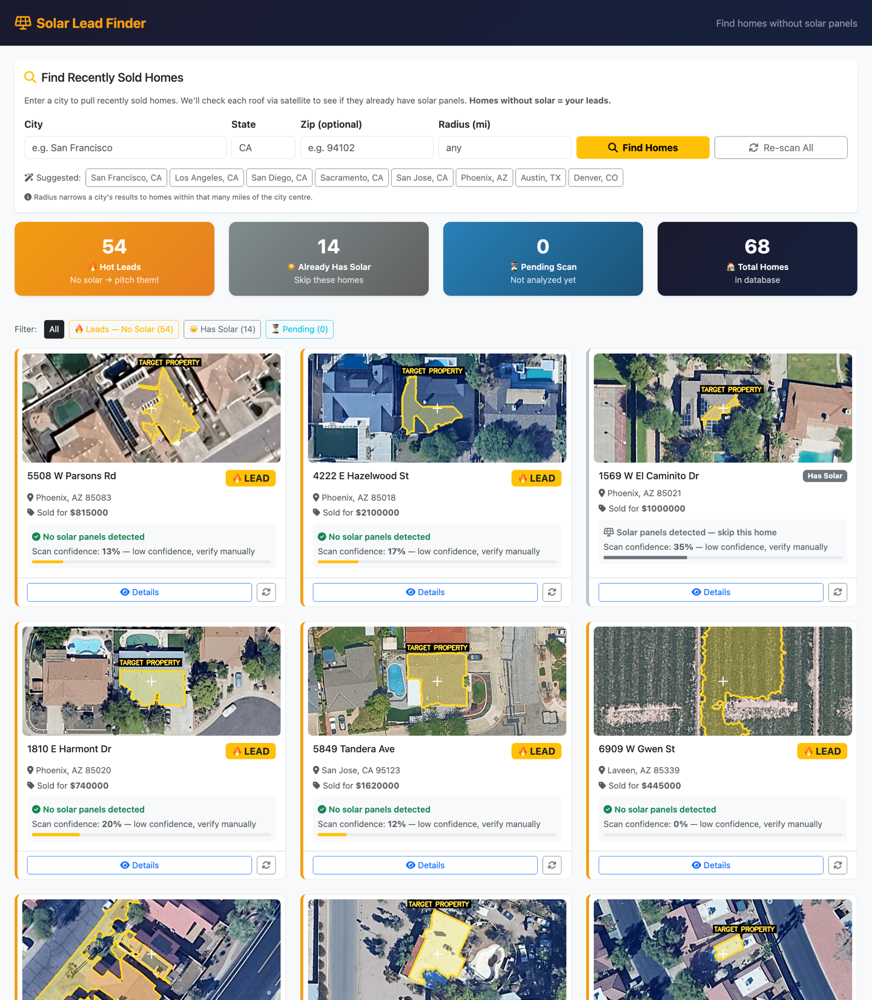
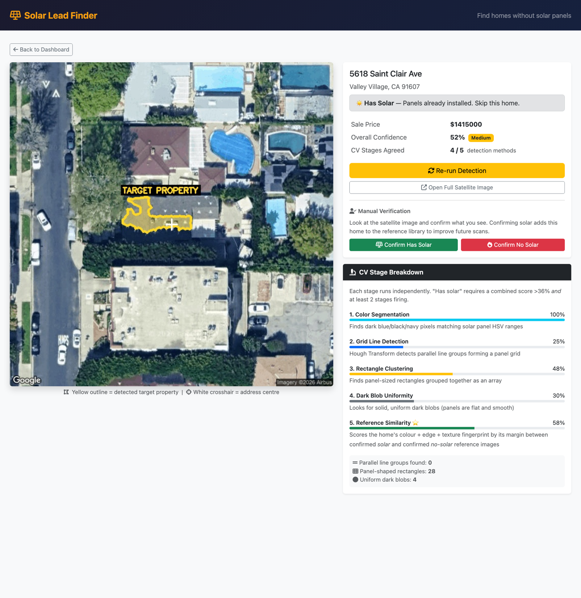

# ☀️ Solar Lead Finder

> **Find the homes that *don't* have solar panels — instant, qualified leads for solar installers.**

[](https://solar-lead-finder-vrxzqxauuq-uc.a.run.app)

[](https://www.python.org/)
[](https://www.djangoproject.com/)
[](LICENSE)

Solar Lead Finder pulls **recently-sold homes** in any city, fetches a **satellite image** of each rooftop, and runs a **computer-vision pipeline** to decide whether solar panels are already installed. Homes **without** panels are flagged as hot leads — because new homeowners without solar are a solar installer's best prospects.

## 🎯 Why it exists
Door-to-door and cold-call solar sales waste enormous time on homes that *already* have panels. This app automates the filtering: enter a city, get back a ranked, map-verified list of un-solared, recently-sold homes.

## 📸 Screenshots
| Leads dashboard | Per-home detection breakdown |
| --- | --- |
|  |  |

The per-home view shows the **transparent 5-stage detection breakdown** — every scan reveals exactly *why* a rooftop was or wasn't flagged, with a live score bar for each computer-vision stage.

## 🌐 Live demo

### ▶ [**Live on Google Cloud Run**](https://solar-lead-finder-vrxzqxauuq-uc.a.run.app)
The production deployment — **Cloud Run** (scale-to-zero) backed by **Neon Postgres**, with rooftop images in **Google Cloud Storage**, live Google Maps imagery, and the MobileNetV3 classifier. Give it a few seconds to wake from a cold start. Full walkthrough in [**`DEPLOY-GCP.md`**](DEPLOY-GCP.md).

### 🚀 Deploy your own in one click (Render)
[](https://render.com/deploy?repo=https://github.com/dgdagreat/solar-lead-finder)

Spins up on Render's free tier with **mock data** out of the box (no API keys) — config lives in [`render.yaml`](render.yaml). Add a `GOOGLE_STREET_VIEW_API_KEY` for live satellite imagery + detection, and a `DATABASE_URL` for persistent Postgres. For a full Cloud Run setup (managed Postgres + object storage + secrets), follow [`DEPLOY-GCP.md`](DEPLOY-GCP.md).

## ✨ Features
- **Search recently-sold homes** by city / ZIP, with an optional **radius** filter (Realty-in-US via RapidAPI).
- **Runs with zero API keys** — falls back to realistic mock homes so anyone can demo the full flow instantly.
- **Rooftop satellite imagery** at zoom 20 (Google Static Maps), with the target building auto-highlighted.
- **5-stage OpenCV detector** scores each roof for solar, with a fully **transparent per-stage breakdown** in the UI.
- **Automatic lead flagging** + a one-click **"Confirm Has/No Solar"** human-in-the-loop that improves future scans.
- **Dashboard** with status filters, per-search scoping, and live lead stats.

## 🧠 How the detection works
The detector ([`detector/solar_detector.py`](detector/solar_detector.py)) fuses **five independent signals**, each keyed to a physical property of panel arrays:

| Stage | Signal | Idea |
| --- | --- | --- |
| 1 | **Color segmentation** | clustered dark-navy/blue pixels (scattered noise is penalized) |
| 2 | **Grid-line detection** | evenly-spaced parallel lines (Hough transform + periodicity check) |
| 3 | **Rectangle clustering** | many near-identical-size rectangles grouped together |
| 4 | **Dark-blob uniformity** | flat, smooth, solid blobs of panel size |
| 5 | **Reference similarity** | margin vs. a library of confirmed solar *and* no-solar fingerprints |

A home is marked **has-solar** only when the weighted score clears a threshold **and ≥ 2 stages agree** — which keeps false positives (missed leads) low.

### On accuracy and the CNN
The app uses a **MobileNetV3 CNN classifier** ([`detector/cnn.py`](detector/cnn.py)) when its bundled ONNX model is available, with the five-stage CV detector as a fallback. Before assigning either solar status or a lead, it checks that a plausible roof is near the address point in the same image; if that check fails, the home is marked **Roof Unverified** and gets no solar or lead label. On an independent, geographically separated test set of 200 roof images, the classifier reached 81.5% balanced accuracy with a decision cutoff selected on the validation set. This is a Queens 2018 roof-centered result; live Google Maps accuracy has not been measured. The app's confirmation flow can collect in-domain labels for future training.

## 🛠️ Tech stack
- **Backend:** Django 6 · Django REST Framework · SQLite *(dev)* · Postgres *(prod)*
- **Vision:** OpenCV · NumPy · Pillow · *(optional)* PyTorch / torchvision
- **Data / APIs:** Google Maps Static API · Realty-in-US (RapidAPI) · ATTOM (fallback)
- **Frontend:** Django templates · Bootstrap 5
- **Async *(optional)*:** Celery · Redis
- **Deploy:** Docker · Google Cloud Run · Neon Postgres · Google Cloud Storage · Secret Manager · gunicorn + WhiteNoise *(see [`DEPLOY-GCP.md`](DEPLOY-GCP.md))*

## 🗂️ Project layout
```
solarleads/   Django project (settings, urls, celery)
homes/        Home model · search views · services (property-data APIs) · dashboard
detector/     CV pipeline — solar_detector, reference_comparator, rooftop_annotator,
              image_fetcher, tasks (orchestration) · experimental cnn + trainer
templates/    dashboard + home detail (with the live 5-stage breakdown)
```

## 🚀 Getting started
```bash
git clone https://github.com/dgdagreat/solar-lead-finder.git
cd solar-lead-finder

python3 -m venv venv && source venv/bin/activate
pip install -r requirements.txt

cp .env.example .env          # optional — leave the keys blank to use mock data
python manage.py migrate
python manage.py runserver
```
Open **http://localhost:8000**, enter a city (try **San Francisco, CA**), and watch it pull homes and score each rooftop.

> 💡 **No API keys?** The app detects that and serves realistic mock homes, so you can explore the entire dashboard → detection → lead flow with zero setup.

### Optional: the CNN experiments
```bash
pip install -r requirements-ml.txt
python manage.py prepare_cnn_data     # build a training set from confirmed homes
python -m detector.cnn_train          # fine-tune MobileNetV3 (Apple-Silicon MPS aware)
```

### Train on independently labeled roofs
The repository also includes a reproducible external-data path. It downloads the
Queens 2018 PV labels and small chips from the New York State orthophoto service;
it does not use Google Maps imagery. Train/validation/test sets are separated by
geographic blocks, and the 40 roofs used for the first external evaluation are
excluded.

```bash
pip install -r requirements-ml.txt
python manage.py prepare_labeled_cnn_data --per-split 100
python -m detector.cnn_train --data data/queens_external_v1 \
  --out media/models/solar_cnn_candidate.pt --epochs 10 --batch 8 \
  --lr 0.0003 --seed 3719
python -m detector.export_cnn_onnx media/models/solar_cnn_candidate.pt \
  detector/models/solar_cnn_queens2018.onnx
```

Labels and original imagery are attributed in the generated `NOTICE.md`. The
data and candidate checkpoint are local artifacts and are not included in git.

## 📊 Evaluation & honest limitations

The original heuristic was evaluated on a balanced 200-roof holdout from the
independently labeled Queens dataset. Its balanced accuracy was **32%** (40% solar
recall, 24% non-solar specificity). A MobileNetV3 candidate trained on separate
geographic blocks reached **79.5% balanced accuracy** on the same 200-example
test split (72% recall, 87% specificity; 159/200 correct). The PyTorch candidate
and split metrics are recorded in `media/models/solar_cnn_candidate.pt`; its
ONNX export is bundled for lightweight app inference.

The app uses a 0.42 solar decision cutoff selected on the validation split. This
yielded 81.5% balanced accuracy on the held-out test set (77% recall, 86%
specificity; 163/200 correct), compared with 79.5% at the default 0.50 cutoff.
This is an external-data result for Queens 2018 orthophotos, not a measured
accuracy for live Google Maps scans. Imagery provider, age, address centering,
and geography can change performance. The app uses the bundled classifier when
it is available, but that does not make the Queens score a live-app accuracy
claim.
The Queens labels cover about 14,000 manually drawn PV polygons and had a
three-annotator quality review ([dataset](https://zenodo.org/records/15084216),
[paper](https://www.nature.com/articles/s41597-025-06523-2)).

## 🧭 Roadmap
- [x] Live hosted demo — [solar-lead-finder.onrender.com](https://solar-lead-finder.onrender.com)
- [x] Test coverage for the detector + property-API parsers
- [x] Train and ship MobileNetV3 with an external geographic holdout
- [x] Publish balanced accuracy, recall, specificity, and confusion-matrix results
- [ ] Map view of leads

## 📄 License
MIT — see [LICENSE](LICENSE).

---
Built by [Daejuan Graham](https://github.com/dgdagreat).
